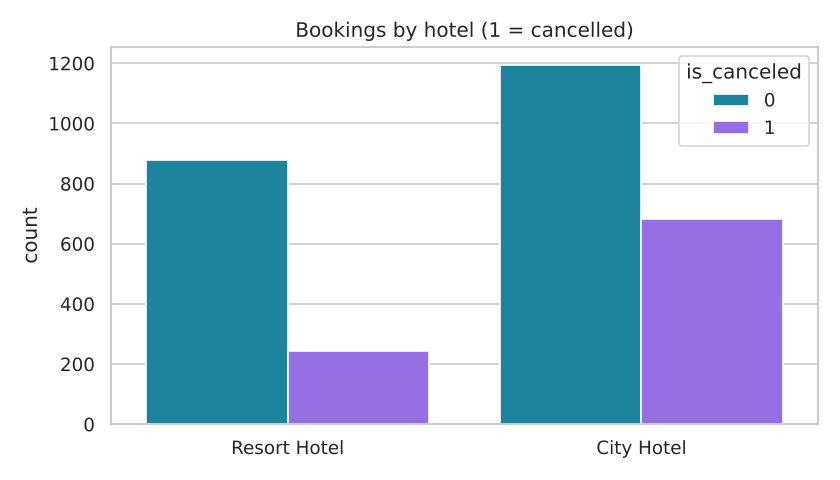
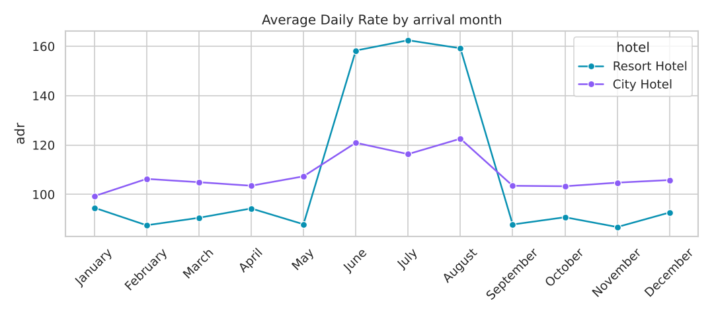
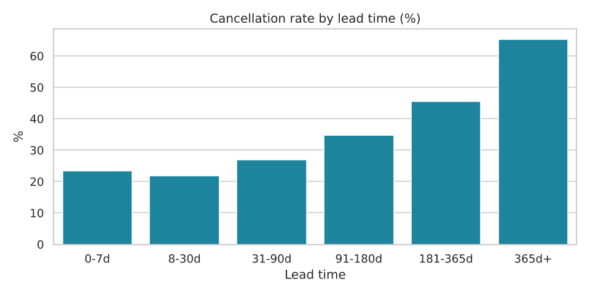
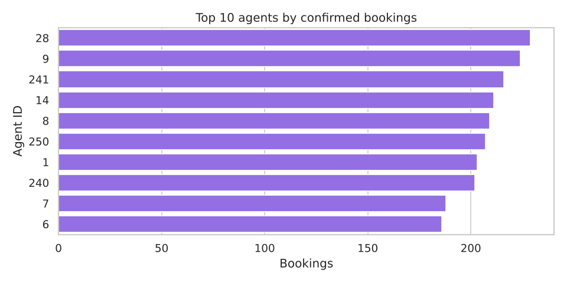

# 🏨 Hotel Booking Analysis

Exploratory data analysis (EDA) of **resort vs city hotel bookings** using Python — cleaning, feature
engineering and visual storytelling to understand pricing (ADR), cancellations and booking channels.
A companion **Tableau dashboard** covered ADR, booking patterns and top-performing agents.

## Questions answered
1. Which hotel type gets more bookings — and how many are cancelled?
2. How does **Average Daily Rate (ADR)** move across the year?
3. Do bookings made far in advance cancel more often?
4. Which **agents** and **market segments** bring the most confirmed bookings?

## Charts

| | |
|---|---|
|  |  |
|  |  |

## Key insights (sample data)
- **City Hotel** takes ~60% of bookings but cancels far more (~36% vs ~22% for Resort).
- **Resort ADR peaks in June–August** — summer pricing is the biggest revenue lever.
- Cancellation rate climbs steadily with **lead time**: 365-day+ bookings are the riskiest — a case for
  stricter deposit rules on early bookings.
- **Online travel agents** dominate the channel mix; a handful of agents drive most volume.

## Run it

```bash
pip install -r requirements.txt
python generate_sample_data.py   # creates data/hotel_bookings.csv (synthetic, same columns as Kaggle)
python analysis.py               # cleans data, saves charts/ and prints a summary
```

> The repo ships with a **synthetic sample** so it runs instantly. For the full analysis, download the
> public *Hotel booking demand* dataset from Kaggle and save it as `data/hotel_bookings.csv`.

## Tech
Python · Pandas · NumPy · Matplotlib · Seaborn · Tableau
